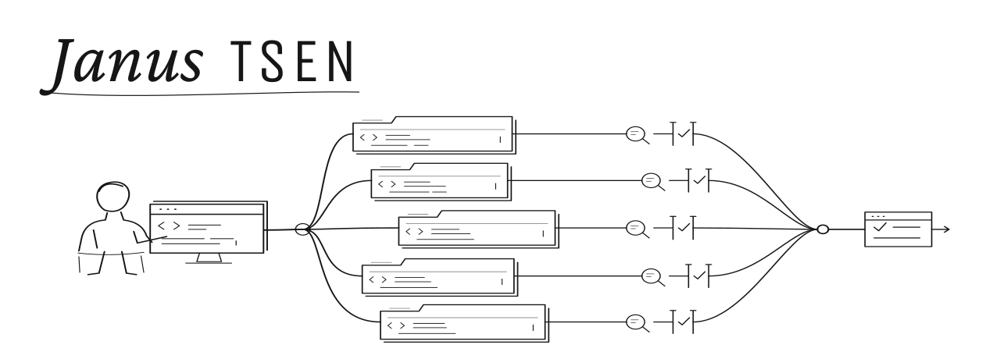

<picture>
  <source media="(prefers-color-scheme: dark)" srcset="assets/banner-dark.svg">
  <source media="(prefers-color-scheme: light)" srcset="assets/banner-light.svg">
  
</picture>

I build software by supervising a fleet of AI coding agents. My firstmate supervisor sends Claude and Codex workers into isolated Git worktrees. They implement changes, run automated reviews, and verify the result in the real app. Pull requests merge once the checks pass, within the approval rules I set for each project.

I study economics at Stanford and co-founded Verdnt Group.

### What I build

- Scholarship discovery pipelines that collect opportunities, check eligibility against source pages, and queue them for review and application.
- Email automation that classifies messages, extracts tasks, and tracks whether they have been completed.
- Research tools for food and drink teams that combine market signals with product information and keep sources attached to the suggestions.

Most of that work is in private repositories. My public [Claude configuration](https://github.com/janustsen/claude-config) contains skills and hooks for my agent workflow. I also use [no-mistakes](https://github.com/janustsen/no-mistakes), a fork of [kunchenguid/no-mistakes](https://github.com/kunchenguid/no-mistakes), for automated code review and verification.

### What I work with

Python for collection, data processing, and automation; JavaScript and TypeScript for web applications; shell scripts for scheduling and connecting tools. I build LLM workflows around source checks, persistent state, and human review.

### Elsewhere

I worked on strategy and analytics at Morgan Stanley, applying agentic AI to wealth-management workflows. I’m joining DRW’s central strategy team as an intern in summer 2027.

[Website](https://janustsen.com) · [LinkedIn](https://www.linkedin.com/in/janustsen) · [X](https://x.com/janustsen)
